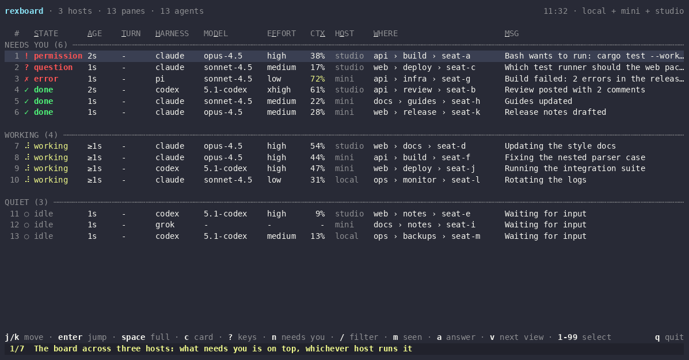

# rexboard

An attention board for the coding agents running in your [Rex](https://www.superlogical.com/rex/docs) panes, across every Rex host: which one is working, blocked or done, for how long, and a jump to its pane.



## Install

Needs Rex, with its `rex` CLI on your PATH. Jumping to a pane also needs the Rex app.

```bash
brew install vanducng/tap/rexboard
```

Without Homebrew:

```bash
curl -fsSL https://raw.githubusercontent.com/vanducng/rexboard/main/install.sh | sh
```

## Quick start

```bash
rexboard
```

The board opens in this terminal. The first run starts `rexboard serve` in the background, which watches this host and every host in `rex hosts`. Rows that need you (blocked, an error, or done and not yet seen) are on top.

Agents straight in a Rex pane report on their own. Inside tmux they need hooks: run `rexboard hooks install` once (`--dry-run` first). See [Agent status](docs/agent-status.md).

| Key | Does |
| --- | --- |
| `j` / `k` | Move down / up |
| `enter` | Jump to the pane |
| `space` | Watch the pane live |
| `a` | Answer the agent |
| `m` | Mark it seen |
| `/` | Filter |
| `?` | Every key |
| `q` | Back, or quit |

## What you can do

- **Read the board.** Rows grouped by what needs you, with a turn card (`c`) under the list that shows what the agent said. [TUI](docs/tui.md)
- **Change the view.** `v` steps through status, table, harness, host, session and one view per extension field; `o` sorts by a column. [Views](docs/tui.md#views)
- **Filter.** `/` narrows by text, `f` by status. [Status filter](docs/tui.md#status-filter)
- **Mark rows and keep favorites.** `*` marks a pane, `'` goes to the marked rows. [Marked rows](docs/tui.md#marked-rows)
- **Keep groups.** `+` keeps a group, `f+` shows only the kept ones. [Kept groups](docs/tui.md#kept-groups)
- **Jump.** `enter` goes to the pane on whichever host owns it; `1`-`99` pick a row, `board --once` is a popup, and [an example](examples/README.md) puts it on a Rex key. [Digits](docs/tui.md#digits), [Popup](docs/tui.md#popup)
- **Answer and close.** `a` answers, `dd` closes a pane, `x` runs an extension's action. [Answer mode](docs/tui.md#answer-mode), [Actions](docs/tui.md#actions)
- **Script it.** `ls`, `watch`, `show`, `answer`, `close` and `jump` take `--json`. [CLI](docs/cli.md)
- **Add columns from any tool.** An extension reads rows and returns fields, marks and actions. [Extensions](docs/extensions.md)
- **Catch a decision.** A `[hooks.ask]` rule shows a turn that asks for one as blocked. [Decision signals](docs/agent-status.md#decision-signals)
- **See what an agent spent.** Model, context, tokens and cost columns, from `rexboard usage`. [Usage on every host](docs/agent-status.md#usage-on-every-host)
- **Wire up hooks.** `rexboard hooks install` sets up Claude Code, Codex and pi. [Setting it up](docs/agent-status.md#setting-it-up)

## How it works


rexboard reads Rex and writes to a pane you chose, through Rex: a jump, an answer or a close. It also writes its own state files, and the hook settings of the agents it names when you run `hooks install`. [System architecture](docs/system-architecture.md) has the details.

## Docs

- [TUI](docs/tui.md): the board, its views and keys, answer mode, `pick` and the popup
- [CLI](docs/cli.md): every command, its output and exit codes
- [Agent status](docs/agent-status.md): where a row's state comes from, decision signals, usage, and what to check when a row looks wrong
- [Extensions](docs/extensions.md): add columns from any tool
- [Configuration](docs/configuration.md): `config.toml`
- [System architecture](docs/system-architecture.md): the pieces, the files and what is written where
- [Decisions](docs/decisions/README.md): why rexboard works the way it does
- [Development](docs/development-guidelines.md): the code map and the tests
- [Deployment](docs/deployment.md): CI, releases and install
- [Contributing](CONTRIBUTING.md): setup, checks and pull requests

## License

MIT. See [LICENSE](LICENSE).
