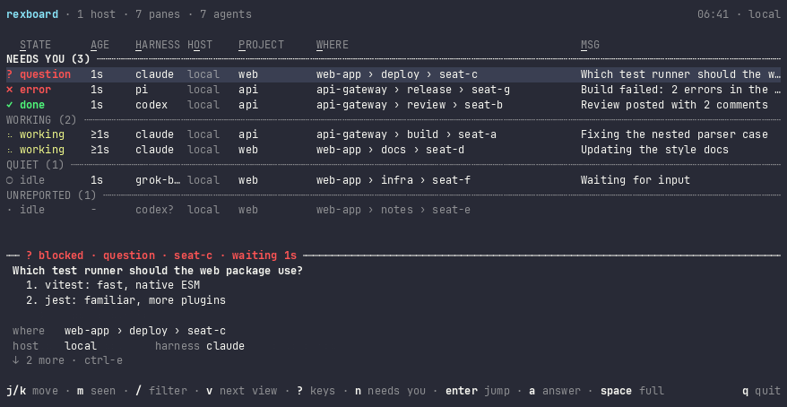
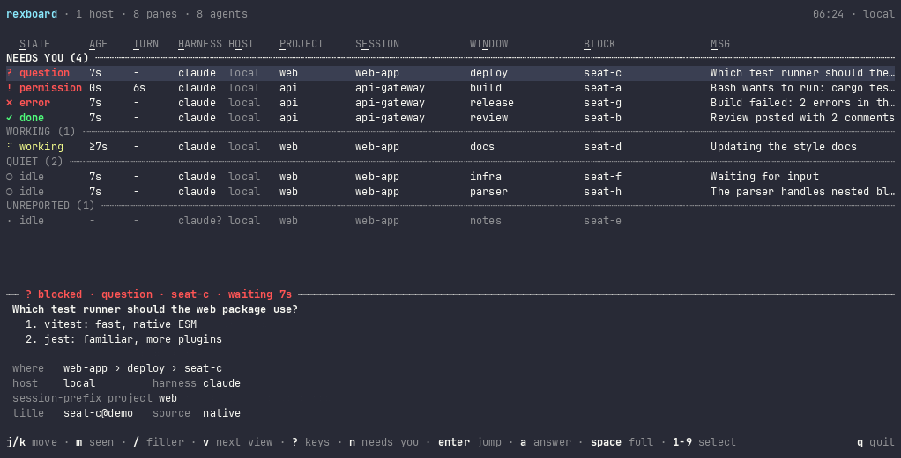
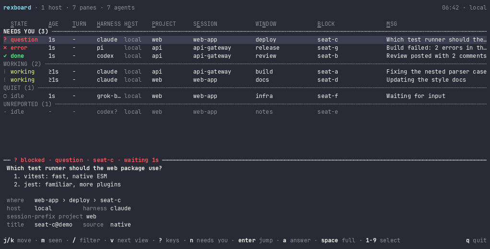
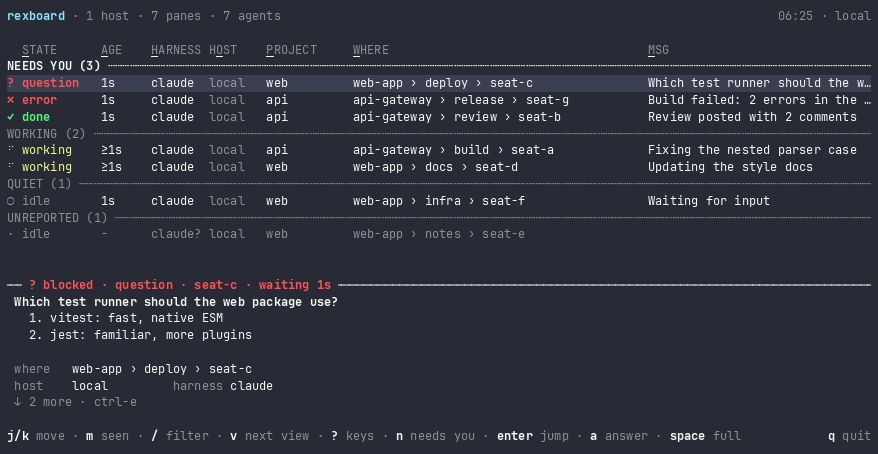
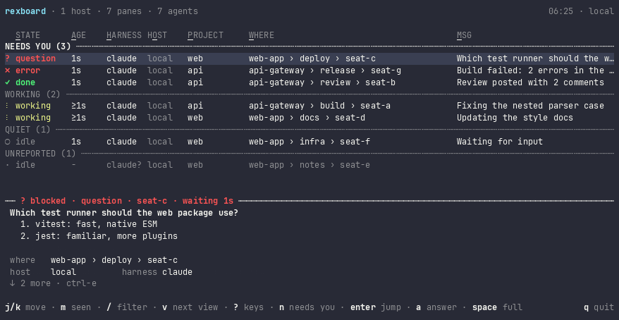
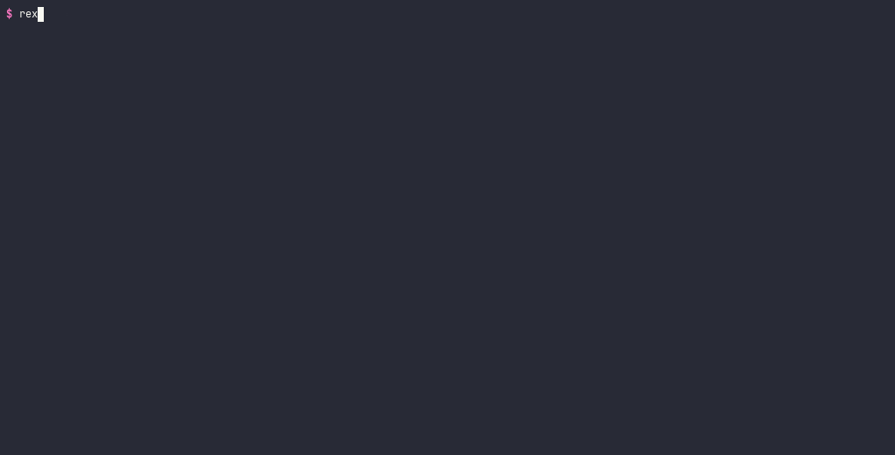

# rexboard

An attention board for coding-agent panes across [Rex](https://www.superlogical.com/rex/docs) hosts: which agent is working, blocked or done, for how long, and a jump to its pane.


## Install

Needs Rex, with its `rex` CLI on your PATH. Jumps also need the Rex app.

```bash
brew install vanducng/tap/rexboard
```

## Quick start

```bash
rexboard                 # the board, in this terminal
rexboard next            # go to the next pane that needs you
rexboard pick            # choose a pane from a list and go to it
rexboard ls --json       # every agent pane, most urgent first
rexboard upgrade         # upgrade to the latest release
```

The first command starts `rexboard serve` in the background. It watches this host and every host in `rex hosts`, and remembers what Rex does not: how long each pane has been in its state, and whether you have seen it.

On the board, `j`/`k` move, `n` goes to the next row that needs you, `enter` jumps to its pane and `-` comes back. `space` watches the pane live, `a` answers it, `m` marks it seen, `/` filters, `o` sorts and `dd` closes a pane after asking. `?` lists every key. The keys are vim's and work in a stock Rex window. See [TUI](docs/tui.md#keys).

A pane needs you when it is blocked, has an error, or is done and you have not seen it. Going to it, or `m`, marks it seen. Its state is what its agent reports to Rex: Claude Code and Codex report on their own in a Rex pane, an agent inside tmux needs a hook, and a pane that reports nothing is read from its title. [Agent status](docs/agent-status.md) says what to check when a row looks wrong.

rexboard only reads Rex, except to jump to a pane and, from the board, to answer or close one.

## Features

Each one is a short recording; open it to watch.

<details><summary><b>The board at a glance</b>: one shape per state, a spinner while working, NEEDS YOU on top, and <code>?</code> for every key</summary>

</details>

<details><summary><b>The card</b>: what the agent said, then its facts; a long message scrolls with <code>ctrl-e</code> and <code>ctrl-y</code></summary>

</details>

<details><summary><b>Answer from the board</b>: pick a dialog's option, or type a reply, after the pane is checked again</summary>

</details>

<details><summary><b>The full view</b>: <code>space</code> shows a pane live, in its own colours</summary>

</details>

<details><summary><b>Vim keys</b>: rows, screens and groups, and a prefix lists the keys that may follow it</summary>

</details>

<details><summary><b>Filter and status</b>: <code>/</code> by text or <code>key:value</code>, <code>f</code> for one status</summary>

</details>

<details><summary><b>Views and sorting</b>: <code>V</code> or <code>:</code> for a view, <code>o</code> and a letter to sort</summary>

</details>

<details><summary><b>Copy and close</b>: <code>yy</code> the message, <code>yp</code> where it runs, <code>dd</code> asks before it closes a pane</summary>

</details>

<details><summary><b>Extensions</b>: a column from any tool; <code>ext ls</code> and <code>ext test</code> check it</summary>

</details>

<details><summary><b>The CLI as an API</b>: what the board shows, as text or JSON</summary>

</details>

<details><summary><b>Icons</b>: words by default, Nerd Font icons with <code>"icons": "nerd"</code></summary>

</details>

## Docs

| Page | What it covers |
| --- | --- |
| [CLI](docs/cli.md) | Every command, its output, JSON fields and exit codes |
| [TUI](docs/tui.md) | The board's layout, views, keys, full view, answer mode and `pick` |
| [Agent status](docs/agent-status.md) | Where each row's status comes from, and what to check when one looks wrong |
| [Configuration](docs/configuration.md) | `config.toml`: the app client, excluded hosts and extensions |
| [Extensions](docs/extensions.md) | Add fields, and a fallback status, from any tool |
| [System architecture](docs/system-architecture.md) | serve, the observers, the Rex calls, the protocol and the files |
| [Decisions](docs/decisions/README.md) | Why rexboard works the way it does, one record per decision |
| [Contributing](CONTRIBUTING.md) | Setup, checks, how to add a key, command or page, and pull request rules |
| [Development](docs/development-guidelines.md) | The code map and the tests |
| [Deployment](docs/deployment.md) | CI, releases, install, upgrade and rollback |

## License

MIT. See [LICENSE](LICENSE).
