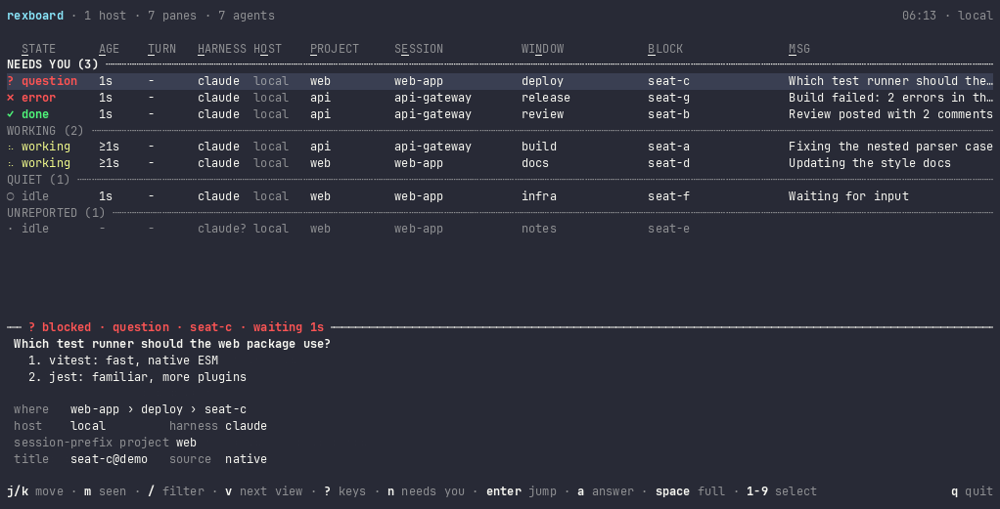

# rexboard

An attention board for coding-agent panes across [Rex](https://www.superlogical.com/rex/docs) hosts: which agent is working, blocked or done, for how long, and a jump to its pane.



## Install

Needs Rex, with its `rex` CLI on your PATH; jumps need the Rex app.

```bash
brew install vanducng/tap/rexboard
```

## Quick start

```bash
rexboard                 # the board, in this terminal
rexboard ls --json       # every agent pane, most urgent first, as JSON
rexboard next            # go to the next pane that needs you
rexboard pick            # choose a pane from the list and go to it
rexboard upgrade         # upgrade to the latest release
```

The first command starts `rexboard serve` in the background. It watches this host and every host in `rex hosts`, and keeps what Rex does not: how long each pane has been in its state, and whether you have seen it.

## What "needs you" and "seen" mean

A pane needs you when it is blocked (often on a permission prompt), has an error, or is done and you have not seen it yet. Going to a pane marks it seen, and so does `s` on the board (`ctrl+s` marks every shown done row seen). A done pane you have seen moves to QUIET; a blocked or erroring one stays in NEEDS YOU until it moves on. A pane is unseen again each time it enters `done`, `blocked` or `error`.

## Where status comes from

Each pane's state is the status its agent reports to Rex. Claude Code and Codex report on their own when they run straight in a Rex pane. An agent inside tmux needs a hook to pass its status through tmux. A pane that reports nothing still shows, with its state read from its title. [Agent status](docs/agent-status.md) has the details, and what to check when a row looks wrong.

## How it works


rexboard reads Rex. Only a jump (blue) writes to it: it focuses the pane on its host and asks the Rex app to show it. [System architecture](docs/system-architecture.md#stack) names the stack and every Rex API call rexboard makes.

## Docs

| Page | What it covers |
| --- | --- |
| [CLI](docs/cli.md) | Every command, its output, fields and exit codes |
| [TUI](docs/tui.md) | The board's layout and keys, and `pick` |
| [Agent status](docs/agent-status.md) | Where each row's status comes from, and what to check when a row looks wrong |
| [Configuration](docs/configuration.md) | `config.toml`: the app client and excluded hosts |
| [System architecture](docs/system-architecture.md) | The stack, serve, the observers, the protocol and the files |
| [Development](docs/development-guidelines.md) | Setup, checks, layout, conventions, tests |
| [Deployment](docs/deployment.md) | CI, release-please, release assets, install, rollback |

## License

MIT. See [LICENSE](LICENSE).
